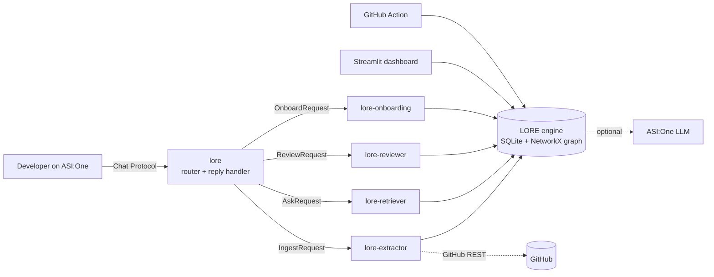

# LORE — Living Organizational Record Engine

**An agent network on Fetch.ai that remembers why your team built things the way it did, and stops you from repeating old mistakes.**

New developers can read the code, but they can't read the history behind it. Why PostgreSQL and not MongoDB? Why is token verification so slow? Which services break if I touch this database? LORE turns merge requests, review comments, incidents, commits and docs into **evidence-backed engineering memory**, links it in a knowledge graph, and checks new changes against it. You use all of it from **ASI:One** chat.

> A document chatbot answers questions. LORE also **pushes back**: propose caching auth responses, and it blocks the change, cites the incident that caused the rule and the merge request that set it, and suggests the alternative the reviewer recorded.

## Agents

| Agent | Role | Address |
|---|---|---|
| `lore` | Public Chat Protocol agent (ASI:One entry point), router, reply handler (show / challenge / reaffirm / remember) | `agent1qghefamymd3qjgpty3q0dny6tsw56n66rmaallz0l5zvhftu9ndfxjxnrur` |
| `lore-extractor` | Memory Extraction Agent: imports folders or GitHub repos, extracts decisions, rules, incidents and commitments, links the graph, and can watch a repo for new merges | `agent1qd68vj3kjumugjfxujwhpatp8xj9fvwfrwyyd5gyvnmpnrvc2utugzh7pnj` |
| `lore-retriever` | LORE Ask: BM25 + graph-boosted retrieval, decision history, dependency impact analysis | `agent1q0led9kmewsfacgu5tmx6j2jdr32cyyz0nykmw3ucm425vvl78h9wrums8k` |
| `lore-reviewer` | MR Review: checks a change description or unified diff against active memories; BLOCK / CAUTION / NO_KNOWN_CONFLICTS, with overrides | `agent1qwesphr6sh2n38ryhcscrfg470pr9wyp3rqydpwy9u6y7dmet3tcq0ell4e` |
| `lore-onboarding` | Briefings for new developers: services, rules, decisions, incidents, key files, people | `agent1qgaxgpgz7mvpuf3nfqkp769adp6st54nl2g86jhkwyne84wsr6m3gpm02sr` |

Addresses come from the seed in `data/.agent_seed` (or `$LORE_SEED`). `python run_agents.py` prints them at startup. Update this table if you change the seed.

**Agentverse profile:** _add your agent's Agentverse URL here_ · **ASI:One chat session:** _add your shared chat URL here_

## Architecture



- **Chat Protocol** (`uagents_core.contrib.protocols.chat`) on the public agent, with the manifest published so ASI:One can discover it.
- **Agent-to-agent orchestration**: the router sends typed requests to the specialists with `ctx.send_and_receive`. They run in one `Bureau`, and only `lore` uses an Agentverse mailbox.
- **Knowledge graph** nodes: memories, sources (MRs, incidents, commits, docs), files, services and people. Edges include `SUPPORTED_BY`, `AFFECTS`, `CAUSED_BY`, `SUPERSEDES`, `MODIFIES`, `PART_OF`, `DEPENDS_ON`, `AUTHORED`, `REVIEWED` and `REFERENCES`. Edges are only added when a source states the relationship, never because two terms appear together.
- **ASI:One LLM** (`asi1`, OpenAI-compatible) is optional. It extracts memories from free-text PRs, writes answers, and judges conflicts. Without a key, LORE falls back to deterministic extraction from ADR-style markers (`Decision:`, `Rule:`, `Why:`, `Affects:`, `Supersedes:`, `Caused by:`) and rule-based conflict checks, so the demo and tests always run.

### Trust rules

- **Every memory carries a verbatim quote** from its source. Memories the LLM extracts are thrown away unless the quote appears character-for-character in the record.
- Suggestions and questions ("maybe we should use GraphQL?") are not stored as decisions.
- **Superseded decisions are kept, not deleted**, so the history stays visible (MongoDB → PostgreSQL).
- Answers separate **verified** facts (from sources) from **inferred risk**. "No known conflicts" always comes with a note that it is not proof of safety.
- When the rules flag a conflict but the LLM calls it unrelated, LORE reports a *possible conflict* rather than dropping it.
- Overrides, challenges and reaffirmations are attributed to the sender's address and kept in an audit log. A challenged (disputed) rule stops blocking reviews until someone reaffirms it.

## Quick start

```bash
python3 -m venv .venv && source .venv/bin/activate
pip install -r requirements.txt
cp .env.example .env        # add ASI1_API_KEY for LLM mode (optional)
```

**1. See the whole story without any accounts.** This runs real uAgents messaging locally: a scripted developer agent chats with LORE over the Chat Protocol.

```bash
python scripts/demo_agents.py
```

**2. Run the agents for ASI:One**

```bash
python run_agents.py
```

1. Open the Agent Inspector link for the `lore` agent:
   `https://agentverse.ai/inspect/?uri=http%3A//127.0.0.1%3A8000&address=<lore address>`
2. Click **Connect → Mailbox** and sign in to Agentverse. The log should now show the mailbox connected.
3. On the agent's Agentverse page, check that the README and the `AgentChatProtocol` manifest are shown.
4. In ASI:One, start a chat with the agent (search for "LORE engineering memory" or use the agent's address), then try the prompts below.

**3. Explore and use in CI**

```bash
streamlit run dashboard/app.py                 # graph, memories, review, audit log
python -m lore chat                            # same commands as ASI:One, in a terminal
python -m lore review --diff my.diff --strict  # exit 1 on BLOCK, used by .github/workflows/lore-review.yml
python -m lore github fetchai/uAgents          # learn from a real repo (better with ASI1_API_KEY)
python -m pytest -q
```

## Demo script (for judges)

| # | Send to LORE | What it shows |
|---|---|---|
| 1 | `status` | 11 imported records → 9 memories, 1 superseded |
| 2 | `Why did we choose PostgreSQL instead of MongoDB?` | Decision MR-31, caused by incident INC-7, supersedes MR-12 |
| 3 | `Can I replace our payment service's database?` | Four dependent services found by graph traversal, the rules that govern them, and "no record proves it is safe" |
| 4 | `review: add a 5 minute Redis cache to verify_token in auth_service/verify.py` | **BLOCK**: cites the rule from MR-42 and incident INC-11, and suggests the reviewer's alternative (scale horizontally) |
| 5 | same, plus `override: load-test env only, tokens never revoked` | The exception is audited, not ignored |
| 6 | `show MEM-007` | Provenance, links and an audit history that now includes your override |
| 7 | `challenge MEM-007: we moved to 30s tokens with push revocation` | The memory changes: disputed rules stop blocking until reaffirmed |
| 8 | `onboard` | A new-developer briefing built from memory |

The sample repository (`data/sample_repo`) is a fictional payments company, Payflow. Its history includes a MongoDB→PostgreSQL migration, an auth caching incident, a reviewer's rule about money and floats, an idempotency decision, and a GraphQL *suggestion* that LORE correctly ignores.

## Project layout

```
lore/engine.py        ingest, link, ask, impact, review, onboard, challenge/remember
lore/extract.py       Memory Extraction Agent (marker parser + ASI:One with a quote-verification gate)
lore/graph.py         NetworkX graph build, component matching, dependents, governance
lore/store.py         SQLite: sources, memories, nodes, edges, audit events
lore/router.py        intent classification + specialist handlers
lore/agents/          uAgents: Chat Protocol front agent, specialists, message models
run_agents.py         Bureau launcher (mailbox for ASI:One)
scripts/demo_agents.py  end-to-end agent demo
dashboard/app.py      Streamlit inspector
tests/                pytest suite (offline, deterministic)
```

## Roadmap

- **Payment Protocol**: a free tier for public repos and paid deep reviews of private repos.
- GitLab and GitHub webhooks in place of polling; posting review results as PR comments.
- Embedding search alongside BM25 for paraphrased questions.
- Inspired by the GitLab-hackathon LORE concept. This is an independent implementation for the Fetch.ai ecosystem.
